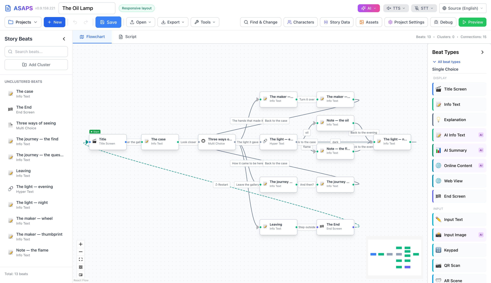
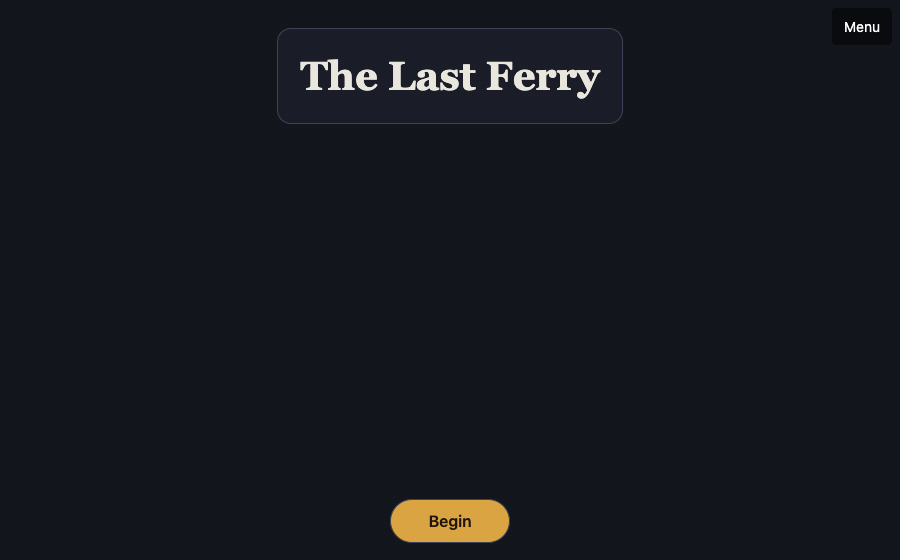

# ASAPS — Advanced Stories Authoring and Presentation System

[](https://github.com/sumo961/ASAPS_New/releases/latest)
[](https://github.com/sumo961/ASAPS_New/actions/workflows/ci.yml)
[](LICENSE)

ASAPS is a visual tool for creating interactive digital narratives (IDNs): stories with choices, conversations, characters who remember, and more than one ending. You build a story as a flowchart of *beats*, arrange each screen in a visual editor, play it in a preview, and publish it as a web page. No programming is needed.

ASAPS is for anyone who wants to explore interactive digital narratives: artists, researchers, narrative designers, teachers and students, writers, and location-based storytellers. It is also for anyone representing complex issues: museums, journalists, public bodies, NGOs and others.

This is the modern version of ASAPS by Hartmut Koenitz, rebuilt in TypeScript from his original ActionScript system (2005–2017, begun at Georgia Tech). Stories are kept in ASML 2.0 (Advanced Stories Markup Language, also created by Hartmut Koenitz); stories in the original XML-based ASML 1.0 can be imported.

**[Try a story](https://sumo961.github.io/ASAPS_New/)** · **[Download](https://github.com/sumo961/ASAPS_New/releases/latest)** · **[User Guide](docs/USER_GUIDE.md)** · **[Release notes](https://github.com/sumo961/ASAPS_New/releases)** · **[Version history](VERSION_HISTORY.md)**



And this is a story made with it, exported as a web page. **[Play it yourself](https://sumo961.github.io/ASAPS_New/)**: it takes about three minutes.



## 🎯 Features

**Write and structure**
- **A flowchart of beats.** 36 beat types: text screens, choices, dialog trees, timed screens, free layouts, video, 360° panoramas, text and keypad input, and more. Drag one in, draw a link, and the story grows. A Script view reads the whole story top to bottom.
- **A Visual Editor for each screen.** Place text, characters, props and meters. A story can reflow to any screen (responsive) or keep a fixed canvas. Themes set the look; a single beat can look different.
- **Stories that remember.** Variables, counters, inventory, timers and a story clock, with conditions and effects on any choice. The Story Data window shows where each one is set and tested.
- **The everyday tools.** Templates to start from, Undo everywhere, an asset manager, Find & Change, dark mode.

**Characters**
- **Feelings, not just numbers.** Mood, emotions, feelings toward others, personality traits and goals. Choices change how a character feels, and meters on screen can follow.
- **Roles.** Let the player choose who they are, or cast a part at random. Each scene is written once and works for whoever plays it.
- **On stage.** Portraits, comic speech bubbles pointing at the speaker, and dimming of characters who aren't speaking.

**Test before you publish**
- **Preview** in its own window, at desktop, tablet or phone size, from the beginning or from any beat "as if" the player had arrived a certain way.
- **Debug tools** that play the story for you: a Problems list, beats that can't be reached, dead ends, checks that can never be true, and an optional check by AI.

**AI, if you want it**
- **For creating:** generate a first story from a prompt, develop ideas in the Ideator, or change an open story with the Co-Designer. Every proposal is shown before it is applied.
- **In the story:** beats that call a model while the story plays, such as a free conversation with a character, or a summary of what the player did.
- **Your choice of provider:** OpenAI, Anthropic, any OpenAI-compatible or local model, and Apple's on-device model on macOS 27. An MCP server lets Claude Desktop build stories. All AI features can be switched off.

**Languages and voice**
- Translate a story into several languages, by hand or with AI, and see which lines went stale when the original changed.
- Read stories aloud and take spoken answers, with cloud or fully local voices.

**Beyond the screen**
- GPS and indoor-location beats, QR codes, AR scenes, embedded web pages and sound placed in space, with a stand-in for the sensors while you write at a desk.

**Share**
- **Export** a story as a web page: one file to send, or a folder for a website.
- **Publish without your keys in the page.** A small relay you deploy with the story holds the AI and voice keys; a script does the deploying.
- **Desktop apps** for macOS, Windows and Linux (beta) that update themselves.
- **Work together** with Git built in: commit, push, pull, merge two versions of a story.

## 🆕 Latest release: v0.9.166, the easy aim release

ASAPS is in **beta**: the core works, and new releases arrive often.

v0.9.166 makes drawing a link forgiving. You no longer have to hit a beat exactly: letting go close to a beat is enough, anything lying on top of it (the link's own line, another link's label) no longer gets in the way, and the beat the link will land on is outlined while you drag. Over empty space nothing is outlined, and that is where the menu from v0.9.165 opens (a new beat, an existing beat by name, or cancel). The Connections number above the flowchart is now exactly the number of lines drawn, and the menu stays inside a short window.

Earlier releases:
- **[VERSION_HISTORY.md](VERSION_HISTORY.md)**: a summary of every release
- **[Progress.md](Progress.md)**: detailed notes with the reasons behind each change
- **[GitHub Releases](https://github.com/sumo961/ASAPS_New/releases)**: installers and release notes

<!-- Only the latest release is described here. On a new release, replace the paragraph above and move the old one to "Release summaries" in VERSION_HISTORY.md. -->

## 📥 Download and install

Installers are on the [GitHub Releases page](https://github.com/sumo961/ASAPS_New/releases/latest). The app checks for updates and tells you when one is ready.

- **macOS** (Intel and Apple Silicon): open the `.dmg` and drag ASAPS Builder to Applications.
- **Windows** (64-bit): run the installer (`.exe`).
- **Linux** (beta, 64-bit x86): a `.deb` package or an AppImage.

**Installing on Linux.** On Ubuntu, Debian and similar, the .deb is the simplest: `sudo apt install ./ASAPS-Builder-<version>-amd64.deb` installs it with everything it needs and adds it to the applications menu (start it from there or with `asaps-builder`). The AppImage runs on most other distributions without installing: make it executable (`chmod +x ASAPS-Builder-<version>-x86_64.AppImage`) and start it. It is also the only Linux build that updates itself. On Ubuntu 24.04 and later the AppImage may refuse to start because the system restricts the sandbox it uses; start it with `--no-sandbox` or use the .deb instead. Your API keys are stored encrypted when the desktop provides a keyring (GNOME Keyring, KWallet); without one they are stored unencrypted and the log says so.

## 📖 Documentation

The **[User Guide](docs/USER_GUIDE.md)** covers everything: a first story in 15 minutes, the interface, every beat type, characters and feelings, conditions and effects, the Preview and Debug tools, translation and voice, AI, and location-based stories. In the app, **Tools ▸ User Guide** and the "Learn more" links open it at the right place.


## 🛠️ Building from source and contributing

```bash
git clone https://github.com/sumo961/ASAPS_New.git
cd ASAPS_New
npm install      # also builds the core packages
npm run dev      # the builder opens at http://localhost:5173
```

Node.js 20 or newer is needed (22 for the desktop app). **[docs/DEVELOPMENT.md](docs/DEVELOPMENT.md)** has the rest: troubleshooting, project structure, scripts, the beat types and how to add one, the ASML file format, the architecture, and the AI and MCP server setup. **[CONTRIBUTING.md](CONTRIBUTING.md)** says how to send a change.

## 📄 License

This project is licensed under the [PolyForm Noncommercial License 1.0.0](LICENSE).

**Free for non-commercial use** - personal projects, research, education, and non-profit organizations.

**Commercial use requires a separate license** - contact for commercial licensing inquiries.

## 🙏 Acknowledgments

- Advanced Stories Group at Georgia Tech
- Dr. Janet Murray for supervision and guidance of the initial project
- All the students using the original ASAPS 2005-2017
- The [COST Action 18230](https://indcor.eu) and the [ARDIN](https://ardin.online) community for continued inspiration
- Made with the help of [Claude](https://claude.ai) and [Kimi](https://kimi.moonshot.cn)

## 📞 Support

For questions and support:
- [Open an issue](https://github.com/sumo961/ASAPS_New/issues) for bug reports

---

Built with ❤️ for interactive digital narratives
